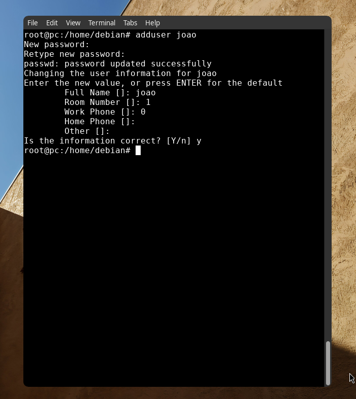
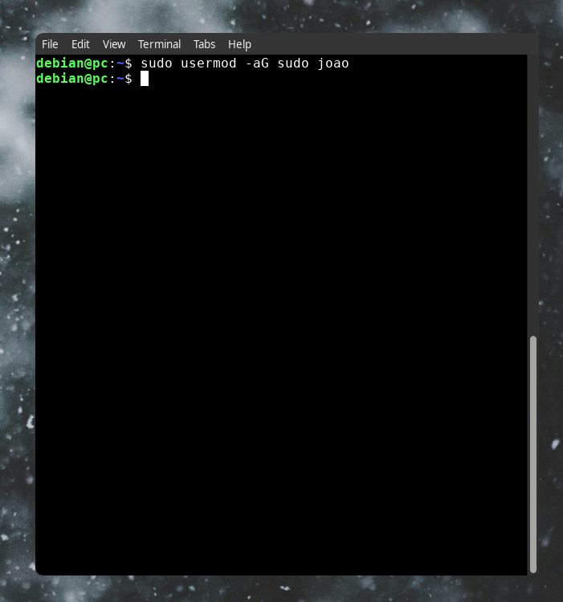
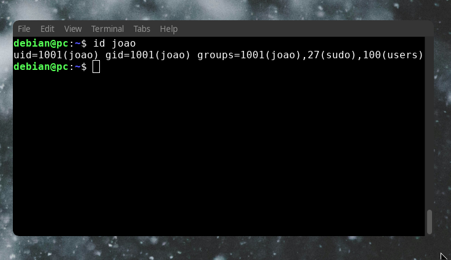
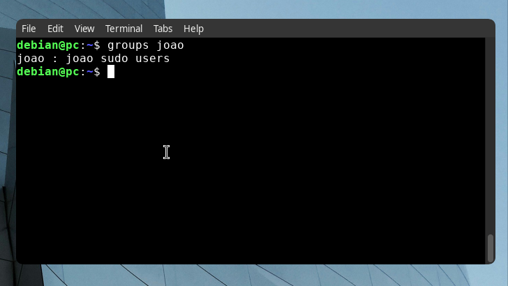

>Laboratório prático desenvolvido durante meus estudos de administração Linux.
# Gerenciamento de Usuários

## Cenário
Novo usuário chamado **joao** precisa de acesso a um servidor Debian. O objetivo é criar uma conta, garantir privilégios administrativos e verificar as configurações de identificação.

## Objetivo
- Criar um usuário no sistema;
- Conceder privilégios administrativos ao novo usuario;
- Confirmar o UID, GID e os grupos associados ao usuário.

## Ambiente
- S.O: Debian 13
- Usuário: debian
## Criar usuário

```bash
sudo adduser joao
```
Cria um novo usuário chamado **joao** e pede por configuração de senha.

## Resultado


## Adicionar o novo usuário ao grupo sudo. 

```bash
sudo usermod -aG sudo joao
```
Adiciona o usuário **joao** ao grupo 'sudo' permitindo a este usuário executar comandos administrativos.

## Resultado


## Verificar o usuário

```bash
id joao
```

## Resultado


## Verificar os grupos 

```bash
groups joao
```

## Resultados



## O que aprendi
- Criar usuário;
- Adicionar usuário ao grupo sudoers;
- Verificar UID  e GID;
- Confirmar grupos do usuários;

## Conclusão
Neste laboratório foi demonstrado o básico de criação de usuários, atribuição de privilégios administrativos e verificação da conta criada


## Referências
https://manpages.debian.org
https://wiki.debian.org/
https://www.gnu.org/software/coreutils
